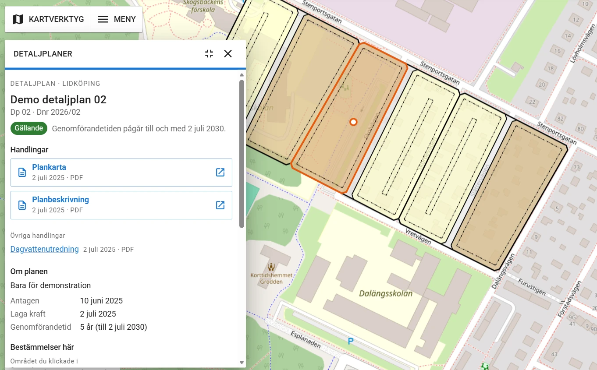
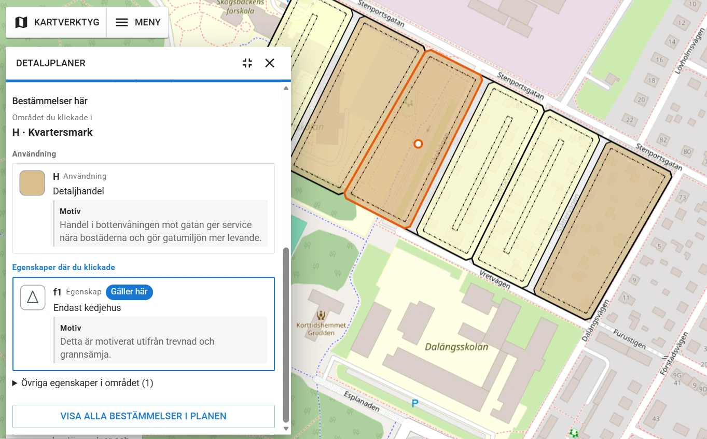

# Rita Detaljplan – integration för Hajk

**Visa kommunens detaljplaner i Hajk, direkt ur plandatabasen.** Ett klick på en plan öppnar ett fönster med planens
uppgifter, plankartan och planbeskrivningen och alla bestämmelser i området med motiv. Det här är integrationen för
[Hajk](https://github.com/hajkmap/Hajk) (4.x), ett plugin som vilken kommun som helst kan använda.

Det är samma panel som i [integrationen för Origo](https://github.com/ritaplan/rita-detaljplan-origomap),
omskriven som ett Hajk-plugin (React och Material UI). Planerna ritas i QGIS-pluginet
[Rita Detaljplan](https://github.com/ritaplan/rita-detaljplan) och checkas in i PostGIS.

<p align="center">
  
</p>

<p align="center">
  
</p>

## Vad du får

| | |
|---|---|
| **Plankartan i Hajk** | Planerna visas som ett vanligt WMS-lager i Hajk, ritat av GeoServer i Boverkets färger och mönster. |
| **Informationsfönster vid klick** | Status i klartext, handlingar (plankarta och planbeskrivning som knappar), syfte, datum och genomförandetid. Bestämmelserna i området med motiv, där de som gäller exakt där man klickade är markerade. |
| **Markering i kartan** | Området man klickade i ramas in. När man pekar på en bestämmelse markeras dess yta. |
| **Alla bestämmelser i planen** | En knapp hämtar bestämmelserna i alla områden (WFS). |
| **Inställningssida i Hajk Admin** | Verktyget ställs in i Hajks administrationsgränssnitt (Kartor, Verktyg, Detaljplaner): adresser, vilka lager som visar planerna och fönstrets utseende. Inget JSON-arbete. |
| **Hajks eget utseende** | Fönstret följer Hajks tema (provat i mörkt läge) och fungerar på dator och telefon. |
| **Bara det som är offentligt** | Pluginet läser samma skrivskyddade vyer som integrationen för Origo. Du bestämmer vilka planstatusar som visas. |

## Så fungerar det

```
Rita Detaljplan ──checka in──▶ PostGIS ──vyer (schemat "publicering")──▶ GeoServer ──WMS / WFS──▶ Hajk + pluginet Detaljplaner
```

Pluginet har ingen egen serverdel. Databasvyerna och GeoServer sätter du upp med
[rita-detaljplan-origomap](https://github.com/ritaplan/rita-detaljplan-origomap) (steg 1–6 i dess
[Kom igång](https://github.com/ritaplan/rita-detaljplan-origomap/blob/main/docs/kom-igang.md)). Hajk läser sedan
lagret `planmosaik_karta` som ett vanligt WMS-lager, och pluginet frågar GeoServer om uppgifterna vid klick.

## Det här behöver du

- Hajk 4.x (provat med 4.3.0), byggd från källkod. Hajks plugin kompileras in i klienten, så det går inte att lägga till i
  en färdigbyggd Hajk.
- Node.js 22 eller senare (det kräver Hajk själv) för att bygga om klienten.
- GeoServer med planerna uppsatta enligt rita-detaljplan-origomap.

## Snabbstart

```sh
git clone https://github.com/ritaplan/rita-detaljplan-hajk.git
cd rita-detaljplan-hajk
node installera.mjs /sökväg/till/din/hajk          # mappen som innehåller apps/
```

Skriptet kopierar pluginet till Hajks klient, lägger `Detaljplaner` i listan över verktyg och lägger inställningssidan i
Hajk Admin. Därefter lägger du detaljplanelagret i din karta, ställer in verktyget i Admin och bygger om klienten (och Admin). Steg för steg: **[docs/installera.md](docs/installera.md)**.

## Dokumentation

| Dokument | Innehåll |
|---|---|
| [docs/installera.md](docs/installera.md) | Installera pluginet, lägg in lagret och verktyget, bygg om. Uppgradera och ta bort. |
| [docs/produktion.md](docs/produktion.md) | Köra Hajk med pluginet i Docker på en server: bygge, upplägg och säkerhet. |
| [docs/konfiguration.md](docs/konfiguration.md) | Alla inställningar, hur klicket tolkas och hur du tillåter anrop mellan Hajk och GeoServer. |
| [docs/felsokning.md](docs/felsokning.md) | Vanliga problem och hur de rättas. |
| [SECURITY.md](SECURITY.md) | Hur säkerheten är tänkt och hur du rapporterar en säkerhetsbrist. |

## Innehållet i repot

| Mapp eller fil | Vad det är |
|---|---|
| `plugin/Detaljplaner/` | Själva pluginet (React och Material UI). Kopieras till `apps/client/src/plugins/`. |
| `admin/detaljplaner.jsx` | Inställningssidan i Hajk Admin. Kopieras till `apps/admin/src/views/tools/`. |
| `installera.mjs` | Lägger in pluginet i en Hajk-mapp, eller tar bort det (`--ta-bort`). |
| `exempel/` | Exempel på lager, verktyg och en `docker-compose.yml` för Hajk. |

## Provat med

Hajk 4.3.0 (klienten och Admin i utvecklingsläge och som produktionsbygge, backend på Node 26 och i en Node 24-behållare på en server), GeoServer 3.0.2 och Rita Detaljplans demoplaner. Provat: klick
på plan och på tom mark, fönstret på dator och mobil, handlingslänkar, alla bestämmelser (WFS), markering i kartan och
anrop genom Hajks egen proxy. Kartan gick i Web Mercator (EPSG:3857) och i SWEREF 99 TM (EPSG:3006, klienten i utvecklingsläge).

Produktionsbygget av Hajk (klient och Admin) med pluginet är provkört i Docker på en server: se [docs/produktion.md](docs/produktion.md).
Inställningssidan i Hajk Admin är provad så här: sidan öppnas med de sparade värdena, en ändring sparas och kartfilen
uppdateras utan att andra verktyg påverkas.

**Inte provat:** kartor i andra koordinatsystem än Web Mercator och SWEREF 99 TM, Hajk med inloggning (Active Directory) och andra Hajk-versioner än 4.3.0.

## Begränsningar

- Hajk Admin är en separat applikation som också måste byggas om för att inställningssidan ska synas. Vill du inte ha den,
  kör installationen med `--utan-admin` och ställ in verktyget i kartans JSON-fil.
- Vektorrutor (variant B i integrationen för Origo) stöds inte av Hajk 4.3. Använd lagret som bildlager (WMS).
- Lagret i Hajk ska vara markerat som inte frågbart i Hajks egen infoklick, annars visas två rutor. Pluginet sköter klicken.
- Texterna i fönstret är på svenska.

## Bidra och ändringar

- [CONTRIBUTING.md](CONTRIBUTING.md): så rapporterar du fel, provar koden och skickar in en ändring.
- [CHANGELOG.md](CHANGELOG.md): vad som ändrats mellan versionerna.
- [NOTICE.md](NOTICE.md): material från andra och deras villkor.

## Licens

GNU General Public License, version 2 eller senare, som Rita Detaljplan. Se [LICENSE](LICENSE). Hajk har egen licens (MIT).
Pluginet blir en del av Hajks klient när det byggs in, och den sammansatta klienten följer då GPL när den delas vidare.
