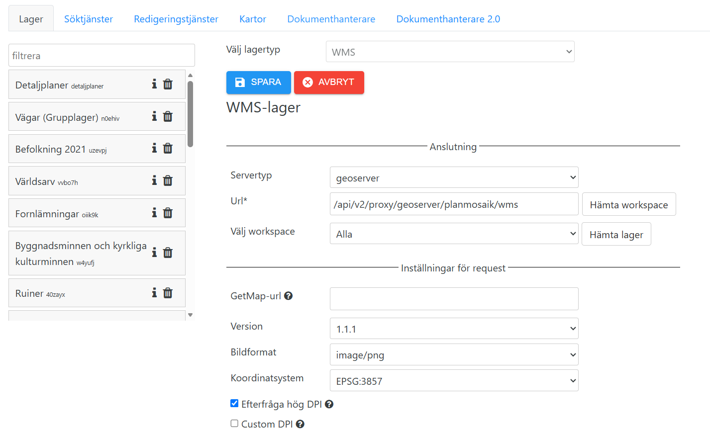

# Installera pluginet i Hajk

Du behöver ha Hajk 4.x som du bygger från källkod, och kunna redigera din kartas JSON-fil. GeoServer med detaljplanerna ska
vara igång enligt [rita-detaljplan-origomap](https://github.com/ritaplan/rita-detaljplan-origomap) (steg 1–6 i dess
[Kom igång](https://github.com/ritaplan/rita-detaljplan-origomap/blob/main/docs/kom-igang.md)).

Räkna med en halvtimme.

## 1. Kopiera in pluginet

Kör skriptet från det här repot och ange mappen som innehåller Hajks `apps/`:

```sh
node installera.mjs /sökväg/till/din/hajk
```

Skriptet gör fyra saker, och kan köras om utan skada:

1. Kopierar `plugin/Detaljplaner` till `apps/client/src/plugins/Detaljplaner`.
2. Lägger `"Detaljplaner"` i `AVAILABLE_TOOLS` i `apps/client/src/constants.js`.
3. Lägger `"Detaljplaner"` i `availableTools` i `apps/client/public/appConfig.json` (om filen har en sådan lista).
4. Lägger inställningssidan `admin/detaljplaner.jsx` i `apps/admin/src/views/tools/` och registrerar den i
   `tooloptions.jsx` (tre rader). Hoppa över detta med `--utan-admin`, eller om du inte använder Hajk Admin.

Det ändrar bara de raderna. Vill du göra det för hand: gör sakerna ovan.

## 2. Lägg in lagret i Hajk

Planerna ritas av GeoServers lagergrupp `planmosaik_karta` och visas i Hajk som ett vanligt WMS-lager. Lägg in det i Hajks
lagerlista, antingen i administrationsgränssnittet (WMS-lager) eller direkt i `layers.json`. Ett färdigt exempel finns i
[`exempel/lager.json`](../exempel/lager.json). Det viktiga:

| Inställning | Värde |
|---|---|
| Adress (`url`) | GeoServers WMS i arbetsytan `planmosaik`, till exempel `https://kartor.exempelkommun.se/geoserver/planmosaik/wms` |
| Lager (`layers`) | `planmosaik_karta` |
| Serverns typ (`serverType`) | `geoserver` |
| Version | `1.1.1` |
| Bildformat | `image/png` |
| Frågbart (`queryable` i `layersInfo`) | **av** |
| Rutor (`tiled`) | av (`singleTile` på) |

<p align="center">
  
</p>

Lägg lagret i en grupp i lagerhanteraren och notera lagrets **id** (till exempel `detaljplaner`). Det behövs i steg 3.

Slå **av** att lagret är frågbart. Annars svarar Hajks egen infoklick också och du får två rutor.

## 3. Lägg in verktyget i kartan

**I Hajk Admin (rekommenderas).** Öppna fliken *Kartor*, välj kartan, klicka *Verktyg* och välj *Detaljplaner* i listan. Kryssa
*Aktiverad*, fyll i WMS-adressen (och WFS-adressen om du vill ha knappen "Visa alla bestämmelser i planen"), kryssa de lager som
visar detaljplanerna och tryck *Spara*. Alla fält förklaras med frågetecknen vid fälten och i
[konfiguration.md](konfiguration.md).

**Eller i JSON.** Kartans inställningar ligger i en JSON-fil i Hajks backend (`apps/backend/App_Data/<karta>.json`). Lägg verktyget
sist i listan `tools`. Ett färdigt exempel finns i [`exempel/verktyg.json`](../exempel/verktyg.json):

```json
{
  "type": "detaljplaner",
  "index": 20,
  "options": {
    "target": "left",
    "position": "left",
    "title": "Detaljplaner",
    "infoUrl": "https://kartor.exempelkommun.se/geoserver/planmosaik/wms",
    "wfsUrl": "https://kartor.exempelkommun.se/geoserver/planmosaik/ows",
    "layerIds": ["detaljplaner"]
  }
}
```

- `infoUrl` är samma WMS-adress som i steg 2. Utan den gör pluginet ingenting.
- `wfsUrl` är valfri: den ger knappen "Visa alla bestämmelser i planen". Lämna den ur om du inte vill ha knappen.
- `layerIds` är id:na på de Hajk-lager som visar detaljplanerna (steg 2). Ett klick på kartan öppnar fönstret när något av
  dem är synligt. Utan `layerIds` öppnas fönstret bara från menyn, och klicket läses när fönstret redan är öppet.
- Alla inställningar finns i [konfiguration.md](konfiguration.md).

Ligger kartan och GeoServer på olika adresser måste anropen tillåtas: se [konfiguration.md](konfiguration.md#anrop-mellan-hajk-och-geoserver).

## 4. Bygg om och starta

```sh
cd /sökväg/till/din/hajk/apps/client
npm run build        # eller npm run dev för att prova

cd ../admin
npm run build        # bara om du använder Hajk Admin och vill se inställningssidan
```

Öppna kartan, tänd lagret Detaljplaner och klicka på en plan. Fönstret öppnas med planens uppgifter. Klickar du utanför
planerna visas "Det finns ingen detaljplan här."

## Uppgradera

Hämta nya versionen av det här repot och kör `node installera.mjs` igen. Bygg om klienten. Pluginet skrivs över, så ändra
inte filerna i Hajk: ändra dem här.

## Ta bort

```sh
node installera.mjs /sökväg/till/din/hajk --ta-bort
```

Ta även bort verktyget ur kartan (Admin: avmarkera *Aktiverad* och spara, eller ta bort det ur kartans JSON-fil), och bygg om
klienten och Admin.
